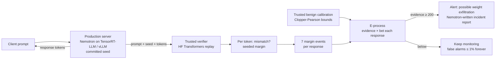

# VILLE — Verified Inference Leak Locator using E-values

> Named after **Ville's inequality**, the result that gives the monitor its anytime false-alarm guarantee.

## Ideation

This is an **ideation-stage hackathon submission** (theme: AI & Cybersecurity, track: Threat Detection / AI Security).
The submission deck describes the plan; this repository holds the working core and will keep growing.
What exists today is a faithful CPU implementation of the detector plus a synthetic test bed.
The real-model replay harness is the next milestone (see Status).

**Team REIGN** — Chittimilla Saitarun · SaiNithin Pokala · CyberForge 2026
Submission deck: [`docs/VILLE_Team_REIGN_Ideation.pptx`](docs/VILLE_Team_REIGN_Ideation.pptx)

## Paper summary (brief)

*Anytime-valid detection of LLM weight exfiltration* — Ortega-Fernandez, Kowalczyk, Warr (MATS Research, NASK,
Anthropic), arXiv:2610.11843, oral at the NeurIPS 2026 workshop "E-Values: From Statistics to ML".

- **Threat.** A compromised inference server can leak model weights, private prompts or any data by using different
  plausible next tokens to represent payload bits. The output channel can be monitored and rate-limited, but not closed.
- **Defence.** The model owner replays each prompt on a trusted verifier with the committed sampling seed
  (Gumbel–Max). The seed prescribes one token per position; a different served token is a *mismatch*.
- **Obstacle.** GPU non-associativity causes benign mismatches: 41.2–87.2% of honest responses contain at least one.
  Benign mismatches concentrate at near-ties (10–40% of tokens in the tightest margin cell, <0.1% in the widest).
- **Method.** For each response, 7 nested binary events "a mismatch at seeded margin ≥ b_m". Their benign rates are
  bounded with Clopper–Pearson on trusted traffic. A betting e-process (KT estimator, growth-optimal bet, cap c = 0.5)
  multiplies evidence after every response; the 7 components are averaged. Alarm when evidence ≥ 1/α = 200.
  Ville's inequality bounds the chance of *ever* false-alarming by α + γ = 1%, over an unbounded horizon.
- **Results** (Llama-3.2-3B, OLMoE-1B-7B, Qwen3-32B, Qwen3-30B-A3B; LMSYS-Chat-1M prompts; 1,000 bootstrap streams of
  250 responses). Seed-blind attack: detected in 100% of streams, median 6–14 responses, 0% benign alarms. The prior
  per-token hard alarm (Rinberg et al. 2025) missed it and alarmed on ≈100% of benign streams. Seed-aware attack:
  detected on dense models at higher rates (e.g. Qwen3-32B at 0.0258 bits/token); not detected on the two MoE models.
- **Limits.** Seed-aware attacks at a few hundredths of a bit per token can evade 250 responses; small secrets can
  still leak; the guarantee needs calibration to transfer (same prompts, model, hardware, serving stack).
- **Future work (paper).** An e-process on the continuous fixed-seed likelihood score to catch slower attackers.

## Idea flow



1. **Problem** — model weights can leak through token choices that look normal.
2. **Why it is hard** — honest GPUs also produce replay mismatches, so single tokens prove nothing.
3. **Insight** — *where* a mismatch happens (its seeded margin) separates noise from attack.
4. **Solution** — replay, measure margins, calibrate on trusted traffic, accumulate evidence, alert.
5. **Guarantee** — anytime-valid: check after every response with a fixed false-alarm budget.
6. **Next** — reproduce the paper on real models, then extend to the continuous-score e-process.

## The problem

A compromised LLM inference server can steal the model's weights — or private prompts — by hiding payload bits
in plausible token choices (e.g. picking the runner-up token in a near-tie to mean "1").
The responses still read normally. The model owner can replay each prompt with the committed sampling seed on a
**trusted verifier** and look for token mismatches, but GPU numerical nondeterminism already causes benign
mismatches in 41–87% of responses. A patient attacker hides inside that noise.

VILLE reproduces the **prompt-level e-process** of Ortega-Fernandez, Kowalczyk & Warr (2026): it turns
whole-response mismatch events at 7 nested seeded-margin thresholds into a betting martingale, accumulates weak
evidence across responses, and alarms when evidence reaches `1/α = 200`. Under the calibration-transfer
assumption, the probability of **ever** raising a false alarm, over an unbounded horizon, is at most `α + γ = 1%`.

## Credit

This is an **independent, unofficial reproduction**. All method credit belongs to the authors:

- I. Ortega-Fernandez, M. Kowalczyk, K. Warr. *Anytime-valid detection of LLM weight exfiltration.*
  NeurIPS 2026 Workshop "E-Values: From Statistics to ML". [arXiv:2610.11843](https://arxiv.org/abs/2610.11843)
- R. Rinberg et al. *Verifying LLM inference to detect model weight exfiltration.* [arXiv:2511.02620](https://arxiv.org/abs/2511.02620) (hard-alarm baseline)
- A. Karvonen et al. *DiFR: Inference verification despite nondeterminism.* [arXiv:2511.20621](https://arxiv.org/abs/2511.20621)

## What's here

| Path | What it does |
|---|---|
| `ville/eprocess.py` | e-process monitor: margin thresholds, nested events (Eq. 2), Clopper–Pearson bounds (Eq. 3), KT-estimator bets (Eq. 8), mixture + alarm (Eq. 5–7) |
| `ville/baseline.py` | Rinberg et al. hard per-token alarm (GLS score, τ = −5, rank R = 8) |
| `ville/simulate.py` | **SYNTHETIC** replay-trace generator: benign, seed-blind and seed-aware attackers |
| `examples/run_synthetic.py` | Table-1-style evaluation with bootstrap streams; saves `results/evidence_paths.png` |
| `tests/` | validity and power checks |

## Quickstart

```bash
pip install -r requirements.txt
python -m pytest -q tests
python examples/run_synthetic.py --streams 200
```

## Synthetic results (our run, `--streams 200 --seed 0`)

**These come from synthetic traces, not from the paper's models.** They only show the pipeline works end to end.

```
setting                  bits/tok  e-proc resp. to alarm e-proc % (atk/ben)  baseline % (atk/ben)
seed-blind                 0.1503  3 [3-3]               100.0 / 0.0           0.0 / 0.0
seed-aware d_max=0.02      0.0285  184 [97-234]           73.5 / 0.0           0.0 / 0.0
seed-aware d_max=0.05      0.0687  14 [12-19]            100.0 / 0.0           0.0 / 0.0
seed-aware d_max=0.1       0.1312  5 [5-7]               100.0 / 0.0           0.0 / 0.0
```

Caveats: the simulator's seed-aware `d_max` caps the seeded margin directly (the paper caps a fixed-seed score
gap), and it does not model the benign low-rank prescriptions that make the baseline false-alarm in the paper,
so the baseline columns here are not comparable to the paper's.

## Status

- [x] e-process monitor (Section 2 + Appendix B)
- [x] Rinberg et al. hard-alarm baseline
- [x] synthetic simulator + bootstrap evaluation
- [x] tests
- [ ] real replay harness: Hugging Face `transformers` trusted verifier vs. a vLLM / TensorRT-LLM "production" server, seeded Gumbel–Max sampling, on Llama-3.2-3B and NVIDIA Nemotron Nano
- [ ] LMSYS-Chat-1M prompts with the paper's 125 / 125 / 250 splits
- [ ] real seed-blind (arithmetic coding) and seed-aware (top-two binary) codecs
- [ ] continuous-score e-process on the fixed-seed likelihood score (the paper's future work)
- [ ] Nemotron-written SOC alerts when the monitor fires
- [ ] live dashboard

## License

Our code is MIT-licensed (see `LICENSE`). The paper is CC BY 4.0 and belongs to its authors.
